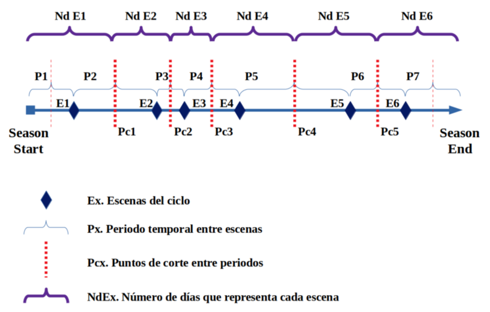
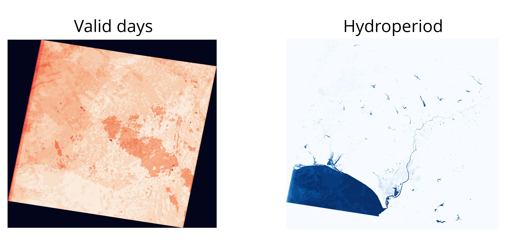
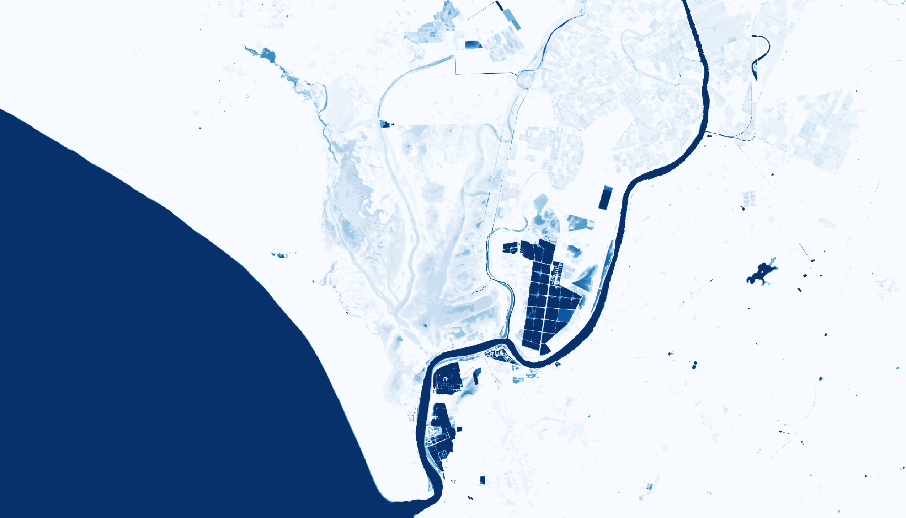

# Phydroperiod

Python library for calculating hydroperiod (flood days) from water mask time series.

## How it works

The hydroperiod calculation distributes 365 days among available scenes based on their temporal position within the hydrological cycle (September 1st - August 31st):



## Installation

```bash
pip install phydroperiod
```

For development:

```bash
git clone https://github.com/Digdgeo/Phydroperiod.git
cd Phydroperiod
pip install -e ".[dev]"
```

## Basic Usage

```python
from phydroperiod import compute_hydroperiod

# Calculate hydroperiod from a directory with water masks
results = compute_hydroperiod("/path/to/water_masks")

print(f"Hydroperiod: {results['hydroperiod']}")
print(f"Valid days: {results['valid_days']}")
print(f"Normalized (0-365): {results['normalized']}")
```

## Mask Requirements

- Format: GeoTIFF (.tif)
- Default values: 0 = dry, 1 = water, 2 = nodata (clouds, shadows, etc.)
- Filenames: must start with date in YYYYMMDD format (e.g., `20200915_flood.tif`)

Values are configurable:

## Available Functions

### `compute_hydroperiod(input_path, output_path=None, normalize=True, ...)`

Complete pipeline that executes all processing steps:

```python
from phydroperiod import compute_hydroperiod

# Basic usage (default values: 0=dry, 1=water, 2=nodata)
results = compute_hydroperiod(
    input_path="/path/to/masks",
    output_path="/path/to/output",  # optional
    normalize=True,  # generates hydroperiod normalized to 365 days
)

# With custom values
results = compute_hydroperiod(
    input_path="/path/to/masks",
    water_value=1,      # value representing water
    dry_value=0,        # value representing dry land
    nodata_value=255,   # value representing nodata
)
```

### Individual Functions

```python
from phydroperiod import (
    calculate_scene_weights,
    process_masks,
    accumulate_hydroperiod,
    normalize_hydroperiod,
)

# 1. Calculate weights per scene
weights = calculate_scene_weights(mask_files)

# 2. Process masks (generates intermediate products)
intermediate_dir = process_masks(input_path, weights=weights)

# 3. Accumulate total hydroperiod
hydroperiod_path, valid_days_path = accumulate_hydroperiod(intermediate_dir)

# 4. Normalize to 365 days
normalized_path = normalize_hydroperiod(output_path)
```

## Hydrological Cycle

The calculation is based on the hydrological cycle running from September 1st to August 31st of the following year. Each scene receives a proportional weight based on its temporal position within the cycle.

## Generated Products

| File | Description |
|------|-------------|
| `*_flood_rec.tif` | Flood days per scene |
| `*_dry_rec.tif` | Dry days per scene |
| `*_valid_rec.tif` | Valid days per scene |
| `hydroperiod_YYYY_YYYY+1.tif` | Accumulated hydroperiod |
| `valid_days_YYYY_YYYY+1.tif` | Accumulated valid days |
| `hydroperiod_nor_YYYY_YYYY+1.tif` | Normalized hydroperiod (0-365) |

## Example Output


*Accumulated valid days (left) and non-normalized hydroperiod (right) for the 2023-2024 hydrological cycle in Doñana, Spain.*


*Normalized hydroperiod (0-365 days) for the same cycle.*

## Roadmap

- [ ] Google Earth Engine integration for water mask retrieval
- [ ] Ndvi2Gif integration for automatic mask generation
- [ ] CLI for terminal usage
- [ ] Support for multiple hydrological cycles
- [ ] Leafmap integration for interactive visualization

## Authors

- **Diego García Díaz** - Development, implementation, and nodata handling methodology
- **Javier Bustamante Díaz** - Hydroperiod calculation methodology design

## License

MIT
